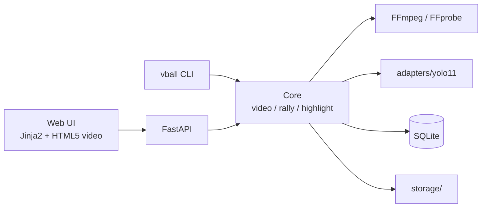

# ARCHITECTURE

## V0–V1：單一 Python 專案



CLI 與 API 呼叫同一套 Core，Core 不依賴 Web。

| 層 | 選擇 | 升級時機 |
|---|---|---|
| 核心 | Python + FFmpeg（subprocess） | — |
| CLI | typer（或 argparse） | — |
| API | FastAPI | — |
| Web UI | Jinja2 + 原生 HTML5 `<video>` | 互動複雜時改 React |
| Job | `ProcessPoolExecutor` + SQLite job 表 | 多人上傳時改 Redis/RQ |
| DB | SQLite | Beta 多使用者時改 PostgreSQL |
| Storage | 本機 `storage/` | 上線時改 R2/S3 |
| AI | Ultralytics YOLO11，經 Adapter 包裝 | — |

## 規劃中的資料夾結構

```text
Project/
├── CLAUDE.md
├── README.md
├── pyproject.toml
├── config/
│   └── settings.yaml        # 模型路徑等（*.local.yaml 不進 Git）
├── src/vball/
│   ├── cli.py
│   ├── video/
│   │   ├── probe.py
│   │   └── clip.py
│   ├── rally/
│   ├── highlight/
│   ├── adapters/
│   │   └── yolo11_adapter.py
│   └── api/
├── tests/
│   ├── fixtures/make_fixtures.py
│   └── test_*.py
├── legacy/                  # 舊腳本，唯讀參考
├── data/
│   ├── LICENSES.md
│   └── licenses/            # 同意證明（不進 Git）
├── storage/ outputs/        # 執行輸出（不進 Git）
└── docs/
```

## 未來演進（Beta 之後）

Web / Mobile → API → Object Storage → Queue → GPU Worker → PostgreSQL → Report / Highlight。

不在 V0–V1 拆分微服務。
