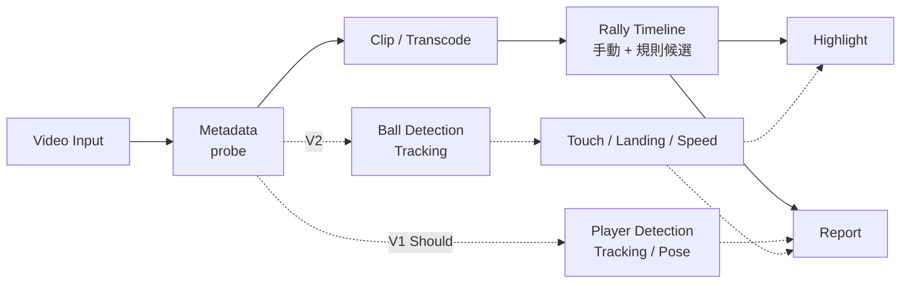

# DEVELOPMENT_FLOW

## 系統資料流



實線為 Must，虛線為 Should / Later，不得阻擋實線交付。

## 模組 I/O 契約

| 模組 | Input | Output | 狀態 |
|---|---|---|---|
| `video.probe` | 影片路徑 | `VideoMetadata`（JSON） | W1 |
| `video.clip` | 影片、start_ms、end_ms、output、mode | MP4 + `clip.json` + log | W2 |
| `rally` | VideoMetadata、人工標記 | `rallies.json` | W5–W7 |
| `highlight` | rallies.json、評分規則 | highlight MP4 + `highlight.json` | W8 |
| `adapters.yolo11` | 影格、模型設定 | `detections.json` | W9 |

時間一律以 **毫秒（int）** 表示，由時間戳計算，不以「影格數 ÷ fps」換算（影片可能為 VFR）。

## VideoMetadata（W1，草案）

```json
{
  "path": "D:/.../20260719.mp4",
  "duration_ms": 5935,
  "width": 872,
  "height": 490,
  "video_codec": "h264",
  "r_frame_rate": "30/1",
  "avg_frame_rate": "35400/1187",
  "fps_avg": 29.82,
  "is_vfr_suspected": false,
  "has_audio": true,
  "audio_codec": "aac",
  "size_bytes": 1628114
}
```

`is_vfr_suspected`：`true` / `false` / `null`（rate 資訊不足，無法判斷）。只比較 r 與 avg frame rate，屬啟發式判斷，不保證 CFR。

### CLI 輸出契約

- stdout 只輸出 JSON；主控台編碼（如 cp950）無法表示的字元改以 `\uXXXX` 跳脫，JSON 仍有效。
- 錯誤輸出到 stderr：`ERROR [錯誤代碼] 訊息`；無法表示的字元以 `?` 取代。
- 結束代碼：0 成功、1 可預期錯誤、2 參數錯誤。

## clip.json（W2，已實作）

每次切片輸出 `<名稱>.mp4`、`<名稱>.json`、`<名稱>.log` 三個檔案。

```json
{
  "input": "D:/.../cfr30_audio.mp4",
  "output": "D:/.../outputs/copy.mp4",
  "mode": "copy",
  "requested_start_ms": 1500,
  "requested_end_ms": 2500,
  "actual_start_ms": 1000,
  "actual_end_ms": 2500,
  "boundary_error_ms": 500,
  "tolerance_ms": null,
  "frame_accurate": false,
  "input_vfr_suspected": false,
  "status": "warning",
  "warnings": ["copy 模式起點對齊 Keyframe，邊界誤差 500 ms"],
  "elapsed_ms": 304,
  "ffmpeg_cmd": ["ffmpeg", "..."],
  "vball_version": "0.0.1",
  "created_at": "2026-10-22T00:45:19+08:00"
}
```

| 欄位 | 規則 |
|---|---|
| `actual_start_ms` | accurate = 要求起點；copy = 起點當下或之前最近的 Keyframe（找不到為 null + warning） |
| `actual_end_ms` | actual_start + 輸出 video stream 長度（不用 format duration，避免 AAC 前置延遲） |
| `boundary_error_ms` | max(起點誤差, 終點誤差) |
| `tolerance_ms` | accurate = 1.5 格（依 fps_avg）；copy = null |
| `frame_accurate` | 只有 accurate 且誤差 ≤ 容許值才為 true；copy 一律 false |
| `status` | 有任何 warning 為 `warning`，否則 `ok`；超過容許值仍保留輸出 |
