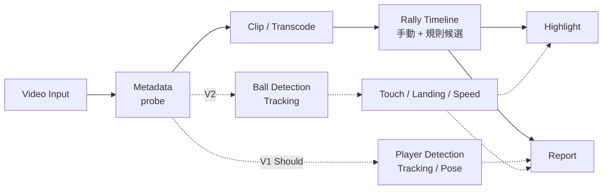

# DEVELOPMENT_FLOW

## 系統資料流



實線為 Must，虛線為 Should / Later，不得阻擋實線交付。

## 模組 I/O 契約

| 模組 | Input | Output | 狀態 |
|---|---|---|---|
| `video.probe` | 影片路徑 | `VideoMetadata`（JSON） | W1 |
| `video.clip` | 影片、start_ms、end_ms、output、mode | MP4 + `clip.json` + log | W2 |
| `rally` | VideoMetadata、人工標記 | `rallies.json` | W5–W7 |
| `highlight` | rallies.json、評分規則 | highlight MP4 + `highlight.json` | W8 |
| `adapters.yolo11` | 影格、模型設定 | `detections.json` | W9 |

時間一律以 **毫秒（int）** 表示，由時間戳計算，不以「影格數 ÷ fps」換算（影片可能為 VFR）。

## VideoMetadata（W1，草案）

```json
{
  "path": "D:/.../20260719.mp4",
  "duration_ms": 5935,
  "width": 872,
  "height": 490,
  "video_codec": "h264",
  "r_frame_rate": "30/1",
  "avg_frame_rate": "35400/1187",
  "fps_avg": 29.82,
  "is_vfr_suspected": true,
  "has_audio": true,
  "audio_codec": "aac",
  "size_bytes": 1628114
}
```

## clip.json（W2，草案）

```json
{
  "input": "D:/.../20260719.mp4",
  "output": "outputs/clip_0001.mp4",
  "mode": "copy",
  "requested_start_ms": 1000,
  "requested_end_ms": 4000,
  "actual_start_ms": 967,
  "actual_end_ms": 4000,
  "boundary_error_ms": 33,
  "frame_accurate": false,
  "status": "ok",
  "warnings": [],
  "created_at": "2026-10-19T10:00:00+08:00"
}
```

欄位定案前可調整；變更須同步此文件。
