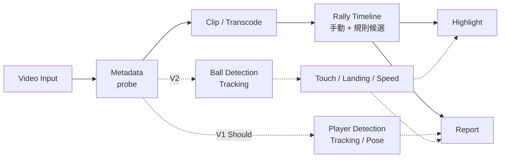

# DEVELOPMENT_FLOW

## 系統資料流



實線為 Must，虛線為 Should / Later，不得阻擋實線交付。

## 模組 I/O 契約

| 模組 | Input | Output | 狀態 |
|---|---|---|---|
| `video.probe` | 影片路徑 | `VideoMetadata`（JSON） | W1 |
| `video.clip` | 影片、start_ms、end_ms、output、mode | MP4 + `clip.json` + log | W2 |
| `rally` | VideoMetadata、人工標記 | `rallies.json` | W5–W7 |
| `highlight` | rallies.json、評分規則 | highlight MP4 + `highlight.json` | W8 |
| `adapters.yolo11` | 影格、模型設定 | `detections.json` | W9 |

時間一律以 **毫秒（int）** 表示，由時間戳計算，不以「影格數 ÷ fps」換算（影片可能為 VFR）。

## VideoMetadata（W1，草案）

```json
{
  "path": "D:/.../20260719.mp4",
  "duration_ms": 5935,
  "width": 872,
  "height": 490,
  "video_codec": "h264",
  "r_frame_rate": "30/1",
  "avg_frame_rate": "35400/1187",
  "fps_avg": 29.82,
  "is_vfr_suspected": false,
  "has_audio": true,
  "audio_codec": "aac",
  "size_bytes": 1628114
}
```

`is_vfr_suspected`：`true` / `false` / `null`（rate 資訊不足，無法判斷）。只比較 r 與 avg frame rate，屬啟發式判斷，不保證 CFR。

### CLI 輸出契約

- stdout 只輸出 JSON；主控台編碼（如 cp950）無法表示的字元改以 `\uXXXX` 跳脫，JSON 仍有效。
- 錯誤輸出到 stderr：`ERROR [錯誤代碼] 訊息`；無法表示的字元以 `?` 取代。
- 結束代碼：0 成功、1 可預期錯誤、2 參數錯誤。

## clip.json（W2，已實作，依 Codex Review 修正）

每次切片輸出 `<名稱>.mp4`、`<名稱>.json`、`<名稱>.log`；另外每次執行（成功或失敗）在輸出資料夾的 `vball_runs.jsonl` 追加一筆紀錄（資料夾不可寫時改寫到系統暫存資料夾 `vball/`）。

```json
{
  "mode": "copy",
  "requested_start_ms": 1500,
  "requested_end_ms": 2500,
  "actual_start_ms": 1000,
  "actual_end_ms": 2500,
  "start_basis": "measured",
  "start_error_ms": 500,
  "end_error_ms": 0,
  "boundary_error_ms": 500,
  "tolerance_ms": null,
  "frame_accurate": false,
  "status": "warning",
  "warnings": ["copy 模式起點對齊 Keyframe，起點誤差 500 ms"],
  "match": {"method": "frame_match", "candidates": 9, "best_ms": 1000, "best_mad": 0.0, "second_mad": 2.04, "result": "matched"}
}
```

| 欄位 | 規則 |
|---|---|
| 時間軸 | 一律為 `pts − format.start_time`（與 `ffmpeg -ss` 同基準） |
| `start_basis` | `measured`：輸出第一格與來源候選格（推估起點前後 4 格）縮成 64×36 灰階比對，最佳平均絕對差 ≤ 12，且次佳 ≥ max(最佳 × 3, 最佳 + 0.5)；`estimated`：比對不明確，用推估值（accurate = 要求起點、copy = 起點前最近 Keyframe）；`unknown`：無法推估 |
| `actual_end_ms` | actual_start + 輸出 video stream 長度 |
| `start_error_ms` / `end_error_ms` | 分別記錄；`boundary_error_ms` = 兩者較大者 |
| `tolerance_ms` | accurate = 1.5 格（依 fps_avg）；copy = null |
| `frame_accurate` | 只有 accurate、`start_basis = measured` 且誤差 ≤ 容許值才為 true；copy 一律 false |
| 發布條件 | 輸出須通過 probe、有效 video 長度、完整解碼無錯誤；否則 `OUTPUT_VERIFY_FAILED` 且不留任何檔案 |
| 覆蓋保護 | `.mp4` / `.json` / `.log` 任一已存在且無 `--overwrite` → `OUTPUT_EXISTS`；任一指向輸入 → `INVALID_OUTPUT` |
